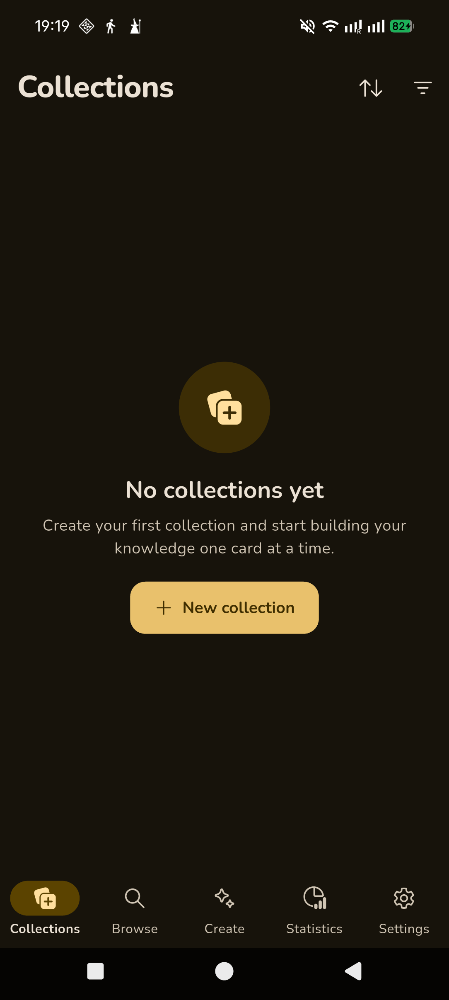
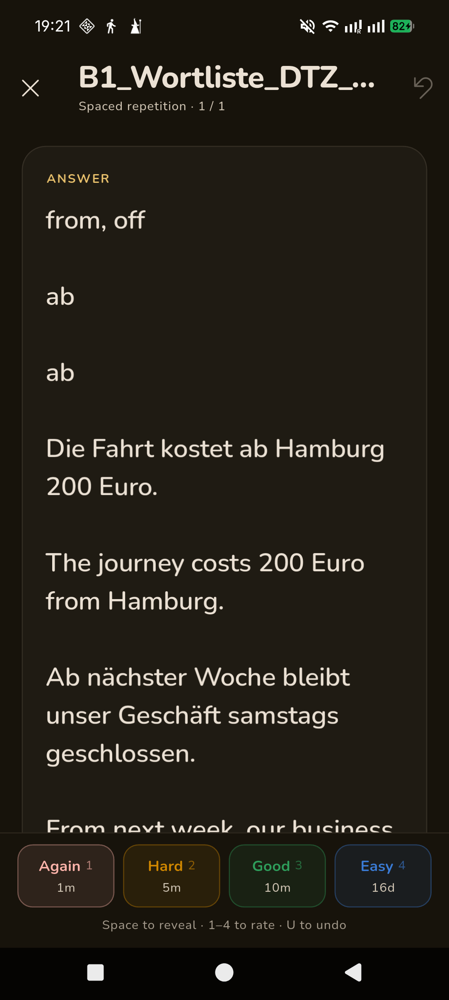
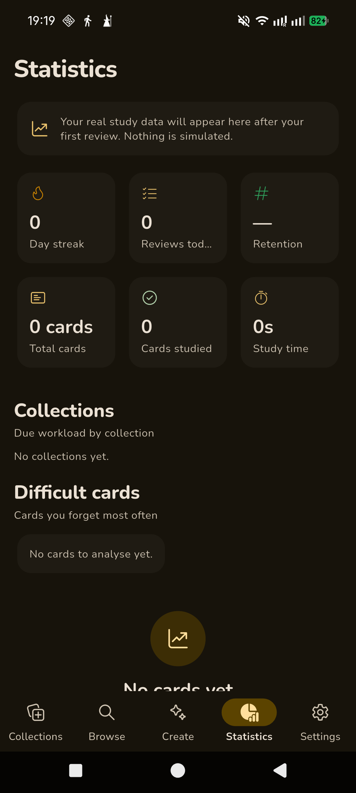
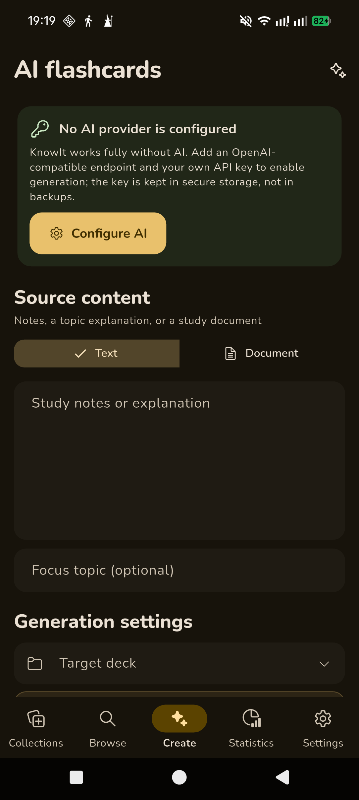
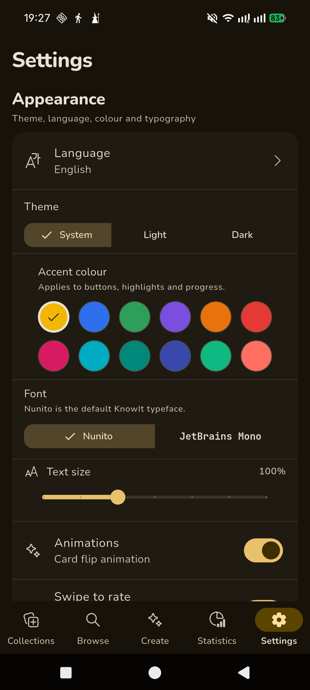
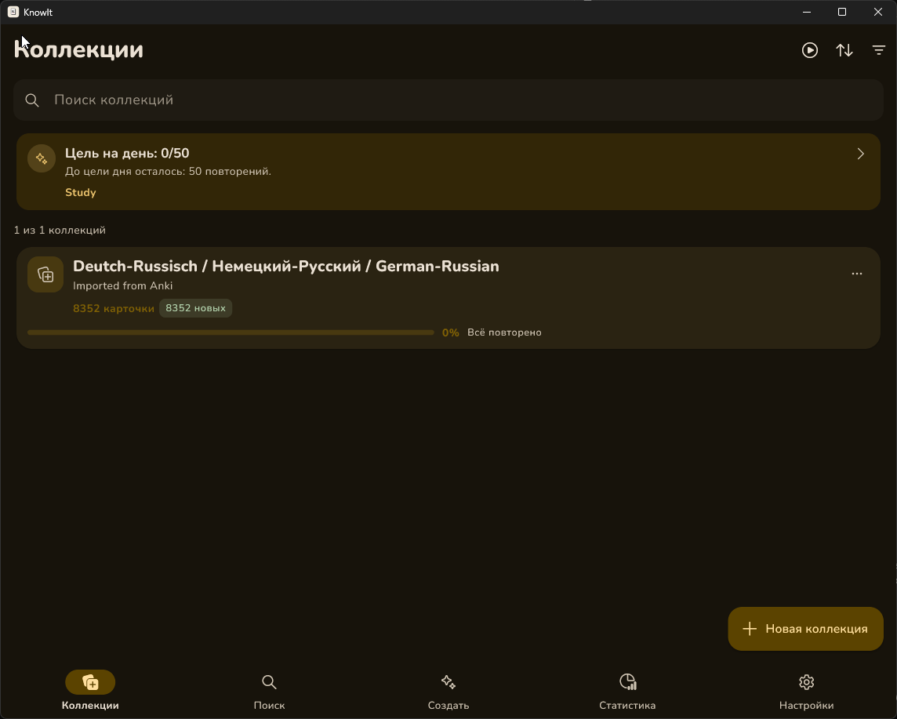

# KnowIt

**A thoughtful spaced repetition flashcard app built for focused, lasting learning.**

  <b>English</b> · <a href="README.ru.md">Русский</a>

[Download Releases](https://github.com/auren0/KnowIt/releases) • [Build Guide](BUILD.md)

---

## About KnowIt

KnowIt is a modern, offline-first flashcard application designed to help you learn and retain knowledge with minimal friction. Built on the modern Free Spaced Repetition Scheduler (FSRS), KnowIt combines intelligent scheduling algorithms with a warm, clutter-free interface, versatile deck hierarchies, rich card formats, and optional AI-assisted flashcard generation.

---

## Screenshots

  <table>
    <tr>
      <td align="center" width="32%">
        
         
        <b>Deck Collections</b> Nested decks with real progress metrics
      </td>
      <td align="center" width="32%">
        
         
        <b>Study Session</b> FSRS interval ratings and reveal controls
      </td>
      <td align="center" width="32%">
        
         
        <b>Statistics & Heatmap</b> Activity history with yearly navigation
      </td>
    </tr>
    <tr>
      <td align="center" width="32%">
        
         
        <b>AI Generation</b> Create cards from notes and documents
      </td>
      <td align="center" width="32%">
        
         
        <b>Personalization</b> Themes, typography, and 12 accent colors
      </td>
      <td align="center" width="32%"></td>
    </tr>
  </table>

   

  
   
  <b>Desktop Interface</b> — Native 64-bit Windows experience with keyboard controls

---

## Features

### Learning & Study
- **FSRS Spaced Repetition**: Powered by the modern `fsrs` algorithm with configurable retention targets, learning steps, and daily review limits.
- **Five Study Modes**: Practice your way with Spaced Repetition (SRS), Quick Review, Cram Mode, Random Shuffling, or Difficult Cards focus.
- **Rich Card Formats**: Create basic, reversed, and cloze-deletion (`{{c1::...}}`) cards with markdown formatting, code spans, and text highlights.
- **Customizable Study Controls**: Full keyboard navigation (`Space`, `1–4`, `U`), optional swipe gestures, rating undo, and answer reveal controls.
- **Media Support**: Attach relevant images and audio files to flashcards with persistent local storage and seamless playback.

### Organization
- **Nested Decks & Collections**: Organize knowledge into structured deck trees with custom descriptions, emoji icons, and accent colors.
- **Search & Filter Syntax**: Instantly find cards using smart filters like `is:due`, `due:today`, `due:overdue`, and `#tag`.
- **Deck Management**: Bulk delete, move, duplicate, and archive cards without disrupting sibling relationships.
- **Study Progress Tracking**: Monitor retention rates, due counts, and daily deck workload at a glance.

### AI-Powered Learning
- **Generate from Notes**: Create targeted flashcards instantly from pasted study notes, summaries, or concept explanations.
- **Document Extraction**: Extract study material locally from PDF, TXT, or Markdown documents before generation.
- **Configurable Providers**: Connect any OpenAI-compatible endpoint with your own API key, securely stored in platform hardware storage.
- **Review Before Saving**: Inspect, edit, remove, and validate duplicate cards before adding them to your decks. Nothing is auto-saved.

### Statistics & Progress
- **Study Statistics**: Review overall retention rates, card stability distributions, and ratings breakdown.
- **Activity Heatmap**: Visualize study consistency with a contribution-style heatmap and yearly navigation.
- **Review History**: Detailed daily study logs and timestamps for every review session.
- **Learning Progress**: Real-time visual metrics tracking new, learning, review, and suspended cards.

### Personalization
- **Adaptive Themes**: Seamless system, light, and dark modes designed for visual comfort.
- **12 Accent Colors**: Choose from carefully balanced palette swatches (Yellow, Blue, Green, Purple, Coral, and more).
- **Refined Typography**: High-legibility font options including Nunito and JetBrains Mono.
- **Multilingual Support**: Fully localized in English and Russian with instant runtime switching.

### Data & Compatibility
- **Anki APKG Import & Export**: Import and export classic Anki packages (`.apkg`) including decks, notes, cloze cards, tags, and media attachments.
- **Live Import Progress**: Non-blocking background extraction with percentage and remaining time estimation.
- **Offline-First Core**: Fully functional without network connectivity; your database stays on your device.
- **Local Backup & Restore**: One-click JSON backup export and timestamped snapshots for complete data ownership.

---

## Supported Platforms

- **Android**: Tested and built for Android (Debug & Release APK).
- **Windows**: Built as native 64-bit Windows desktop application with a standalone Inno Setup installer.

---

## Download

Pre-built binaries are available on the [GitHub Releases](https://github.com/auren0/KnowIt/releases) page:

- **Windows**: Download `KnowIt-Setup.exe` for a per-user, non-elevated installation.
- **Android**: Download `app-release.apk` to install on your mobile device.

To compile KnowIt from source or build your own installers, see [BUILD.md](BUILD.md).
