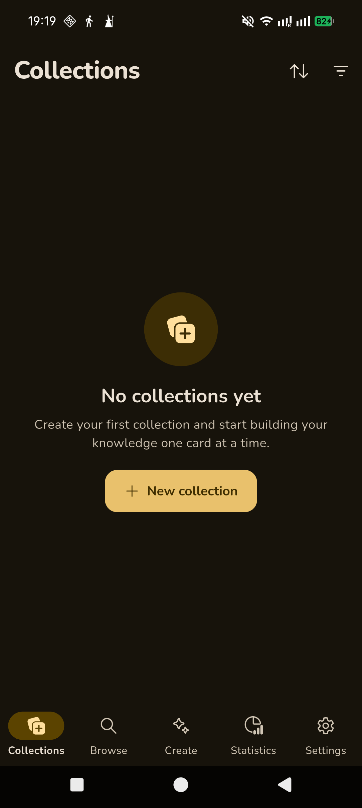
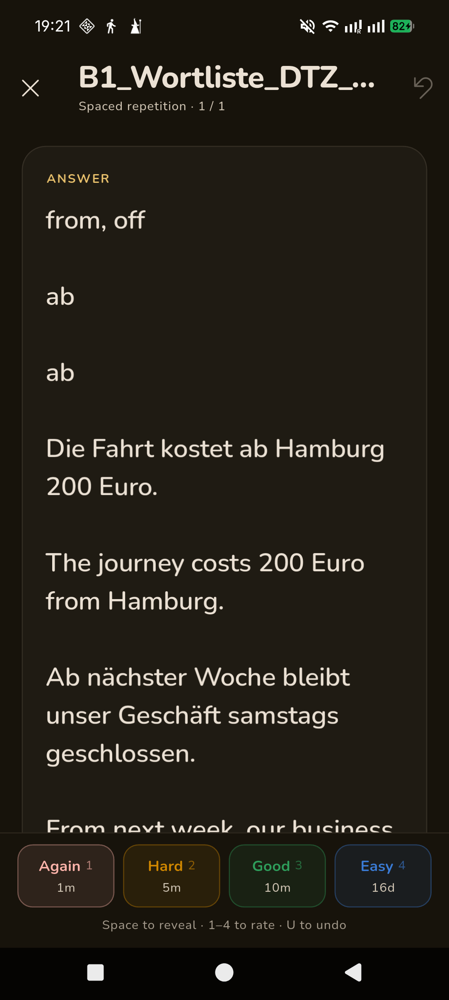
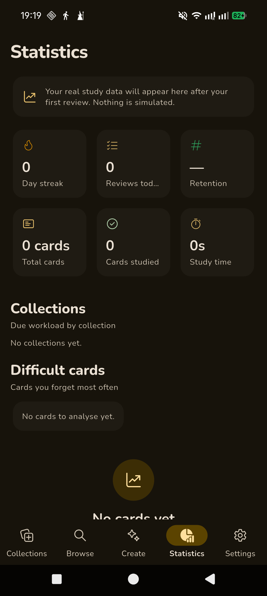
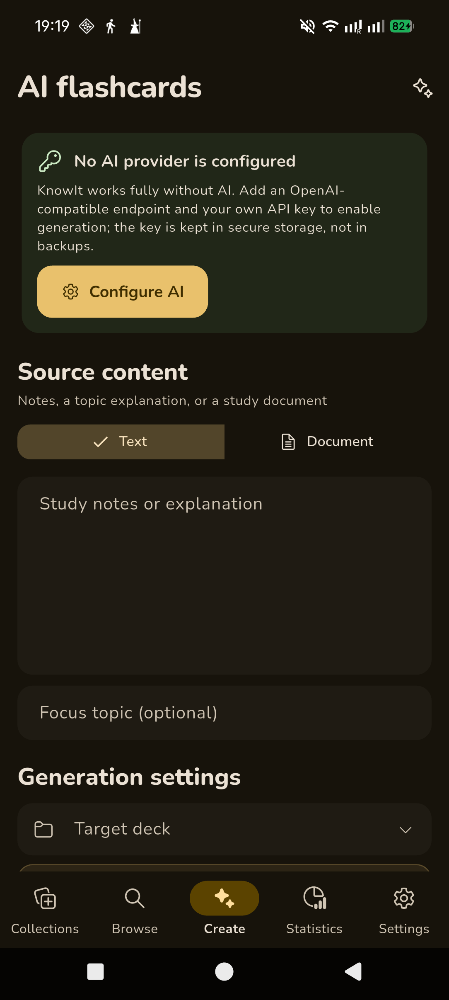
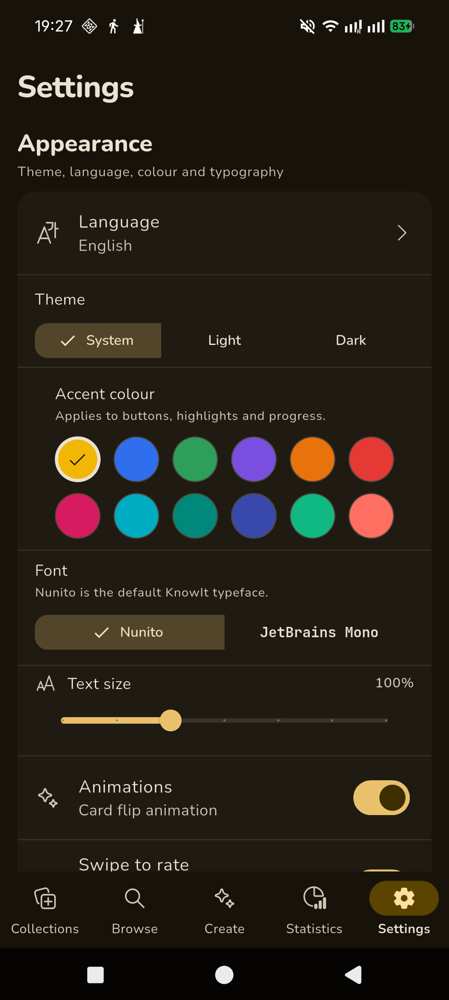
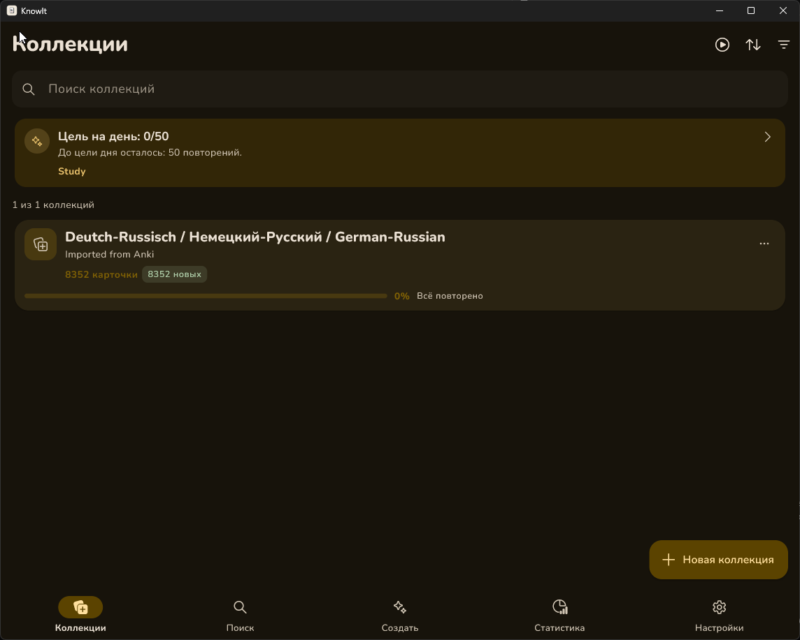

# KnowIt

**Продуманное приложение для интервальных повторений, созданное для осознанного и долгосрочного обучения.**

  <a href="README.md">English</a> · <b>Русский</b>

[Скачать релизы](https://github.com/auren0/KnowIt/releases) • [Инструкция по сборке](BUILD.md)

---

## О проекте KnowIt

KnowIt — это современное приложение для работы с флеш-карточками, ориентированное на эффективное и комфортное усвоение знаний без лишнего шума. Построенное на базе современного алгоритма интервальных повторений FSRS (Free Spaced Repetition Scheduler), KnowIt сочетает умное планирование интервалов, чистый и теплый интерфейс, удобную древовидную структуру колод, гибкие форматы карточек и опциональную генерацию с помощью AI.

---

## Скриншоты

  <table>
    <tr>
      <td align="center" width="32%">
        
         
        <b>Колоды и коллекции</b> Вложенная структура и счетчики прогресса
      </td>
      <td align="center" width="32%">
        
         
        <b>Процесс обучения</b> Оценки интервалов FSRS и показ ответа
      </td>
      <td align="center" width="32%">
        
         
        <b>Статистика и тепловая карта</b> История активности и выбор года
      </td>
    </tr>
    <tr>
      <td align="center" width="32%">
        
         
        <b>Генерация с AI</b> Создание карточек из заметок и файлов
      </td>
      <td align="center" width="32%">
        
         
        <b>Персонализация</b> Темы, шрифты и 12 цветовых акцентов
      </td>
      <td align="center" width="32%"></td>
    </tr>
  </table>

   

  
   
  <b>Версия для Windows</b> — Полноценный настольный интерфейс с поддержкой клавиатуры

---

## Возможности

### Обучение и практика
- **Интервальные повторения FSRS**: Алгоритм `fsrs` с настраиваемыми целевыми показателями удержания, шагами обучения и дневными лимитами.
- **Пять режимов обучения**: Занимайтесь так, как удобно именно вам — интервальные повторения (SRS), быстрый просмотр, зубрежка (cram), случайный порядок или фокус на сложных карточках.
- **Гибкие форматы карточек**: Базовые, обратные и карточки с пропусками (`{{c1::...}}`), с поддержкой Markdown, фрагментов кода и текстовых выделений.
- **Удобное управление повторениями**: Полноценная навигация с клавиатуры (`Пробел`, `1–4`, `U`), жестовое смахивание, отмена оценки и настраиваемое отображение ответа.
- **Мультимедиа**: Прикрепляйте изображения и аудиозаписи к карточкам с надежным локальным хранением и воспроизведением.

### Организация знаний
- **Вложенные колоды и коллекции**: Структурируйте материал в виде дерева папок с описаниями, эмодзи-иконками и цветовыми акцентами.
- **Быстрый поиск и фильтрация**: Мгновенно находите нужные карточки с помощью умных поисковых фильтров (`is:due`, `due:today`, `due:overdue`, `#tag`).
- **Управление колодами**: Пакетное удаление, перемещение, дублирование и архивация карточек с сохранением связей между парными карточками.
- **Контроль прогресса**: Отслеживайте процент удержания, количество карточек на сегодня и общую нагрузку.

### Обучение с поддержкой AI
- **Генерация из заметок**: Создавайте готовые карточки из вставленных конспектов, выжимок и объяснений понятий.
- **Импорт документов**: Локальное извлечение текста из файлов PDF, TXT и Markdown перед генерацией.
- **Гибкая настройка провайдеров**: Подключение любого OpenAI-совместимого сервиса со своим API-ключом, защищенным аппаратным хранилищем системы.
- **Просмотр перед добавлением**: Редактирование, удаление и встроенная проверка дубликатов перед сохранением в колоду. Карточки никогда не сохраняются автоматически.

### Статистика и динамика
- **Подробная статистика**: Наглядный анализ стабильности памяти, распределения карточек и истории ответов.
- **Тепловая карта активности**: Календарь ежедневной активности в стиле GitHub с переключением между годами.
- **Журнал повторений**: Подробная история каждого занятия с точными отметками времени.
- **Визуализация прогресса**: Наглядное разделение карточек на новые, изучаемые, повторяемые и отложенные.

### Персонализация
- **Адаптивные темы**: Системная, светлая и темная темы, разработанные для снижения нагрузки на глаза.
- **12 цветовых акцентов**: Палитра из гармоничных оттенков (желтый, синий, зеленый, фиолетовый, коралловый и другие).
- **Выверенная типографика**: Четкие и комфортные для чтения шрифты Nunito и JetBrains Mono.
- **Двуязычный интерфейс**: Полная локализация на русский и английский языки с мгновенным переключением.

### Данные и совместимость
- **Импорт и экспорт Anki APKG**: Поддержка классических пакетов Anki (`.apkg`), включая колоды, записи, пропуски, теги и медиафайлы.
- **Прогресс импорта в реальном времени**: Фоновая распаковка в отдельном потоке (Isolate) без зависания интерфейса с отображением процента и оценкой времени.
- **Автономность (Offline-First)**: Полная работоспособность без подключения к сети; ваши данные остаются исключительно на устройстве.
- **Локальное резервное копирование**: Экспорт в JSON и создание резервных копий в один клик.

---

## Поддерживаемые платформы

- **Android**: Протестировано и собирается для Android (Debug и Release APK).
- **Windows**: Нативное 64-битное приложение для Windows с удобным установщиком Inno Setup.

---

## Загрузка

Готовые сборки доступны на странице [релизов GitHub](https://github.com/auren0/KnowIt/releases):

- **Windows**: Загрузите `KnowIt-Setup.exe` для быстрой установки в профиль пользователя без запроса прав администратора.
- **Android**: Загрузите `app-release.apk` для установки на мобильное устройство.

Инструкции по сборке из исходного кода приведены в файле [BUILD.md](BUILD.md).
